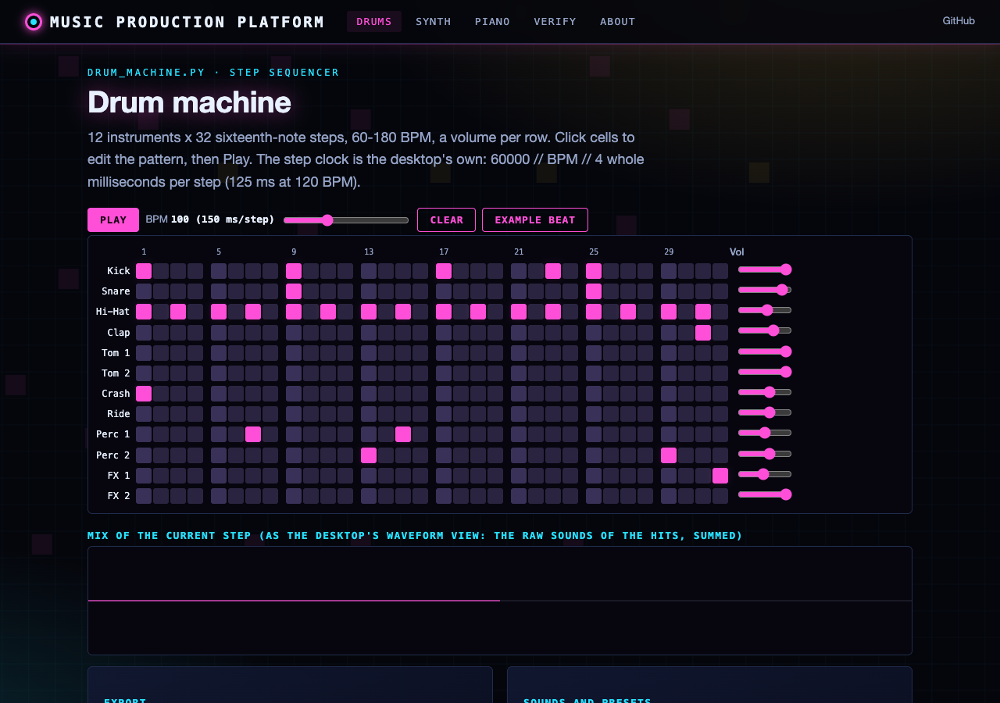
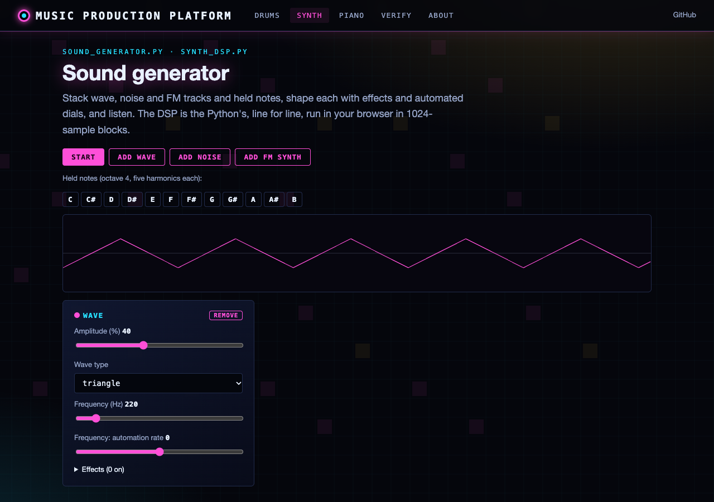
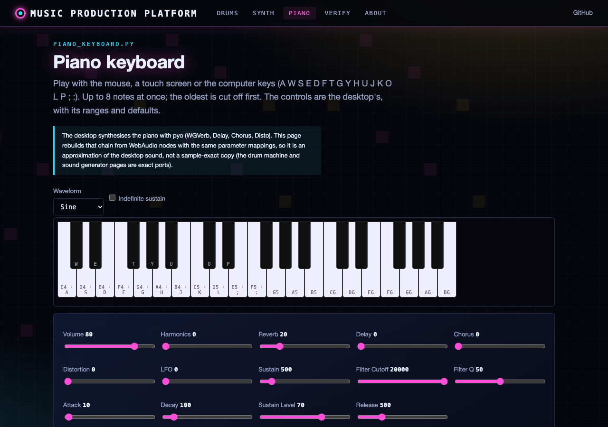
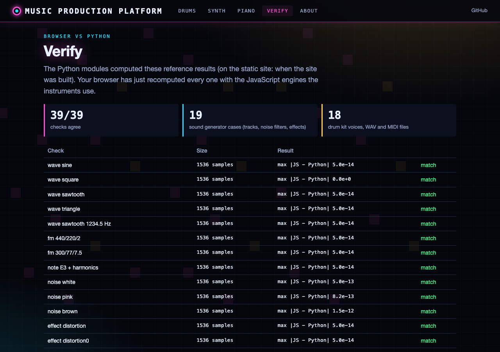

# Music Production Platform

A digital audio workstation (DAW) built with Python and PyQt5. The platform integrates a piano keyboard, drum machine, sample pad, sound generator, recording studio, mixer, and project/preset management into a single tabbed interface with a dark theme (QDarkStyle).

## Features

### Instruments and Tools
- **Piano Keyboard** (`piano_keyboard.py`): Virtual piano with mouse and computer-keyboard input, real-time sound synthesis, customizable instrument presets
- **Drum Machine** (`drum_machine.py`): Grid-based rhythm sequencer with adjustable tempo, per-sample volume, and custom drum sample import
- **Sample Pad** (`sample_pad.py`): Trigger and manipulate audio samples with real-time effects
- **Sound Generator** (`sound_generator.py`): Synthesizer with multiple waveforms (sine, square, saw, triangle), ADSR envelopes, and effects chain
- **Recording Studio** (`recording_studio.py`): Multi-track audio recording and playback

### Audio Engine
- **Audio System** (`audio_system.py`): Core audio engine built on PyAudio for real-time sound output
- **Audio Routing** (`audio_routing.py`): Flexible signal routing between instruments, effects, and outputs
- **Audio Export** (`audio_export.py`): Export projects and tracks to WAV and other formats
- **Mixer** (`mixer.py`): Multi-channel mixer with audio buses, per-channel volume/pan/mute/solo

### Management
- **Project Manager** (`project_manager.py`): Save, load, and organize complete project sessions
- **Preset Manager** (`preset_manager.py`): Create, save, and load presets for piano, drum, sound generator, effects, mixer, samples, and tracks
- **MIDI Controller** (`midi_controller.py`): Connect and map external MIDI hardware
- **Integration Panel** (`integration.py`): Unified control panel linking all components

### Effects
- Reverb, delay, chorus, distortion, and more
- Per-instrument ADSR envelope shaping
- Real-time pitch bend modulation

## Project Structure

```
musicPlatform/
├── synth_dsp.py             # Qt-free sound generator DSP (tracks, effects)
├── drum_engine.py           # Qt-free drum timing, render, MIDI tracks, presets
├── drum_kit.py              # Synthesised drum kit (samples/ and the web)
├── sound_library.py         # Original sounds for samples/ and wav/ (scripts/make_sounds.py)
├── midi_export.py / wav_export.py  # Qt-free MIDI and WAV writers
├── piano_spec.py            # Piano sliders, key map, note frequencies
├── web/                     # Web app (FastAPI) and browser front end
├── main.py                  # Entry point (dependency check, environment setup)
├── enhanced_main_gui.py     # Main tabbed window (EnhancedMainGUI)
├── piano_keyboard.py        # Piano keyboard instrument
├── drum_machine.py          # Drum machine sequencer
├── sample_pad.py            # Sample trigger pads
├── sound_generator.py       # Waveform synthesizer
├── recording_studio.py      # Multi-track recording
├── audio_system.py          # Core audio engine
├── audio_routing.py         # Signal routing
├── audio_export.py          # Export to file
├── mixer.py                 # Multi-channel mixer
├── integration.py           # Integrated control panel
├── project_manager.py       # Project save/load
├── preset_manager.py        # Preset management
├── midi_controller.py       # MIDI hardware support
├── file_dialog_utils.py     # File dialog helpers
├── logger.py                # Logging configuration
├── setup_script.py          # Dependency installer
├── run_music_platform.sh    # Shell launch script
├── presets/                  # Preset storage (drum, effect, mixer, piano, sample, sound, track)
├── samples/                 # Drum machine samples (original, synthesised)
├── wav/                     # More original synthesised drum/bass/effect sounds
├── projects/                # Saved project files
├── logs/                    # Application logs
└── tests/                   # Test suite (pytest)
```

## Requirements

- Python >= 3.8
- PyQt5 >= 5.15
- NumPy >= 1.19
- PyAudio
- Pygame >= 2.0
- SciPy >= 1.5
- pyqtgraph >= 0.12
- qdarkstyle
- soundfile (for audio export)

Optional:
- pyo (piano keyboard sound: without it the piano keys respond but stay silent)
- mido (MIDI export; listed in requirements.txt)
- librosa (advanced audio analysis)
- matplotlib (visualization)
- pydub (additional export formats)
- python-rtmidi (MIDI hardware, with mido)

## Installation

Install dependencies automatically:

```bash
python setup_script.py
```

Or install manually:

```bash
pip install PyQt5 numpy pyaudio pygame scipy pyqtgraph qdarkstyle soundfile
```

## Usage

```bash
python main.py
```

Or use the shell script:

```bash
./run_music_platform.sh
```

The application opens a tabbed window with sections for each instrument, the mixer, project manager, preset manager, and integration panel. Switch between tools using the tab bar at the top.

## Web version

**Live site:** https://gddickinson.github.io/musicPlatform/ (static, runs entirely in the browser)

The site is a working browser version of the instruments:

- **Drum machine**: the 12 x 32 step sequencer with the desktop's step clock (`60000 // BPM // 4` ms), row volumes,
  playback, your own samples per row, DrumPreset files, and WAV / General MIDI export.
- **Sound generator**: wave, noise, FM and held-note tracks, automated dials, the effects rack (Freeverb-style reverb, distortion, EQ,
  vibrato, tremolo, chorus, low-pass), a scope, SoundGeneratorPreset files and WAV export, running in an AudioWorklet
  in 1024-sample blocks.
- **Piano keyboard**: three octaves with the desktop's key map, sliders, ranges and defaults (the pyo sound chain is
  approximated with WebAudio nodes).
- **Verify**: the browser recomputes Python reference results.

The drum and sound-generator logic is ported line for line from the Qt-free modules `drum_engine.py`,
`synth_dsp.py`, `midi_export.py` and `wav_export.py`; node tests (`web/static/*.test.mjs`) check sample buffers to
1e-9 and WAV/MIDI files byte for byte against `tests/fixtures/` (regenerate with `python scripts/make_fixtures.py`).
The drum rows play the synthesised kit of `drum_kit.py`, the same sounds as the desktop's `samples/` (all WAVs in
`samples/` and `wav/` are original synthesised sounds, see THIRD_PARTY.md). The sample pad, recording studio, mixer, routing, project manager and MIDI controller are desktop only.

### Run the web app

```bash
pip install -r requirements-web.txt
python run_web.py            # http://127.0.0.1:8167
```

The local app also offers "Check against the Python" on the drum page (re-renders the pattern in Python and
compares the WAV and MIDI bytes). Tests: `python -m pytest -q tests` and `node web/static/synth_engine.test.mjs`,
`node web/static/drum_engine.test.mjs`. Static build: `python scripts/build_static.py` (published by
`.github/workflows/pages.yml` on push to main).

| Drum machine | Sound generator |
|---|---|
|  |  |
|  |  |

## GUI Framework

Built with **PyQt5** and styled with **QDarkStyle** for a dark production-oriented interface.


---
*Built with AI assistance from [Claude (Anthropic)](https://claude.com/).*
